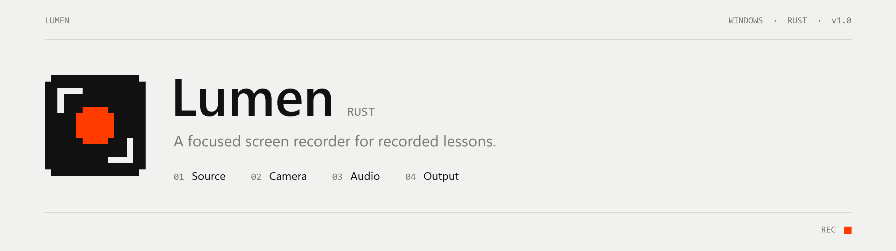
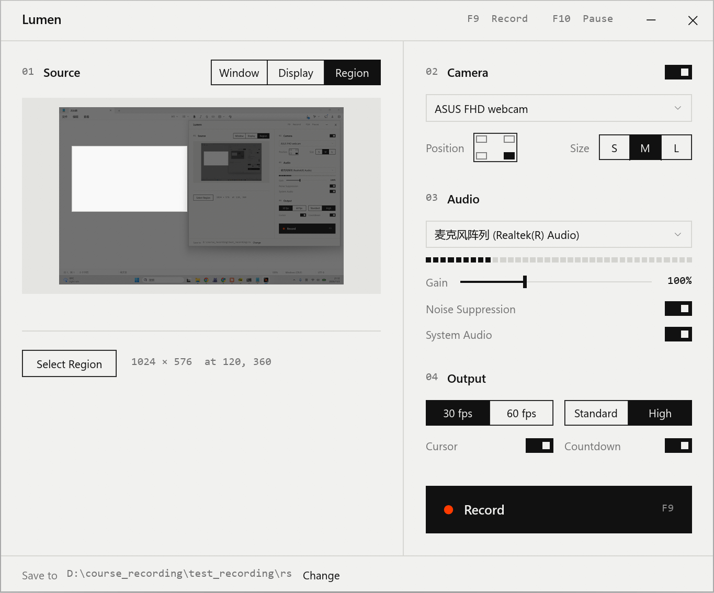

<picture>
  <source media="(prefers-color-scheme: dark)" srcset="docs/banner-dark.png">
  
</picture>

<p>
  
  
  
  <a href="LICENSE"></a>
</p>

Lumen records one window, one display or one region of the screen, with an optional camera
overlay and a clean voice track. This is the Rust version of
[Lumen](https://github.com/Shengwei-Li/lumen): the same app and the same interface, as a single
executable with nothing to install.



## Features

| | |
|---|---|
| **Window capture** | Records a single window, even when other windows cover it. Notifications and pop-ups stay out of the video. |
| **Display and region** | Full display, or a dragged region. Hold Shift to lock 16:9. |
| **Live preview** | A DWM thumbnail of the window, or the display with the region marked. |
| **Camera overlay** | Picture-in-picture in any corner, three sizes, composited on the GPU. |
| **Noise suppression** | RNNoise (nnnoiseless) on the microphone, written into the video as it records. |
| **System audio** | Mixes in what the computer plays, such as listening material. |
| **Pause** | F10 while recording. Paused time leaves no gap in the file. |
| **Hardware encoding** | H.264 through Media Foundation, 30 or 60 fps. |

The recording bar, the countdown and the main window never appear in the video.

## Compared with the C# version

| | C# | Rust |
|---|---|---|
| Download | 48 MB installer | one 5.9 MB `Lumen.exe` |
| Runtime | .NET 8 (bundled) | none |
| Clean audio | aligned to the video after recording | mixed in live, clock-locked |
| Stop to saved file | seconds | about 0.1 s |
| Crash-safe file | fragmented MP4 | plain MP4, finalized at Stop |

## Shortcuts

| Key | Action |
|---|---|
| `F9` | Start or stop recording |
| `F10` | Pause or resume, while recording |
| `Shift` | Lock region selection to 16:9 |
| `Esc` / right click | Cancel region selection |

Recordings are saved as `yyyy-MM-dd HH.mm <source>.mp4` in the folder shown at the bottom of the
window. Settings live in `%APPDATA%\Lumen-rs`.

## Build

```bash
cargo build --release
```

Requires Rust 1.88 or later with the MSVC toolchain. The executable is
`target/release/lumen.exe`. A build fills `target/` with about 1 GB; `cargo clean` reclaims it.

The exe icon is `assets/lumen.res`, built from `assets/lumen.ico` by `python assets/make_res.py`
and linked by `build.rs`. The banners come from `python docs/make_banner.py`.

## How it works

```
capture thread   Windows.Graphics.Capture → crop → shared texture (keyed mutex)
compositor       own D3D11 device, steady frame rate: shared texture + camera → encoder
audio worker     WASAPI mic and loopback → 48 kHz → RNNoise → mix → encoder
clock            starts at the first frame, stands still while paused; audio is paced by it
encoder          Media Foundation transcoder → H.264 + AAC → MP4
```

Windows sends frames only when the picture changes, so the compositor builds every output frame
itself; a still slide records at a steady rate instead of stretching the timeline.

`vendor/windows-capture` is [windows-capture](https://github.com/NiiightmareXD/windows-capture)
2.0.1 (MIT) with one added method, `VideoEncoder::send_surface`, so composited textures reach the
encoder without a copy through the CPU.

The interface is drawn with [egui](https://github.com/emilk/egui); `src/theme.rs` follows the C#
version's `Theme.xaml` measure for measure. The recording bar, countdown and region overlay are
plain Win32 windows.

For development, `lumen --record <window title|display> <seconds> <out.mp4>` records without the
interface (`LUMEN_CAMERA`, `LUMEN_REGION=x,y,w,h` and `LUMEN_PAUSE=a,b` add the rest), and
`LUMEN_SHOW_IN_CAPTURE=1` lets screenshots see Lumen's own windows.

## Acknowledgements

[windows-capture](https://github.com/NiiightmareXD/windows-capture) (MIT) ·
[egui](https://github.com/emilk/egui) (MIT / Apache-2.0) ·
[cpal](https://github.com/RustAudio/cpal) (Apache-2.0) ·
[nnnoiseless](https://github.com/jneem/nnnoiseless) (BSD-3-Clause) ·
[windows-rs](https://github.com/microsoft/windows-rs) (MIT / Apache-2.0)

## License

[MIT](LICENSE)
